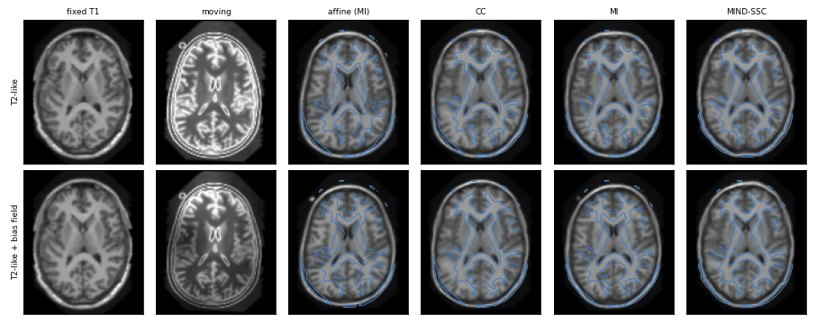

# Multimodal registration with MIND-SSC

When the fixed and moving images come from different modalities (T1- and T2-weighted MRI, MRI and CT, ...),
the same tissue has different intensities in the two images. Cross-correlation (`cc`) assumes the intensities
are linearly related inside each window and mutual information (`mi`) only assumes a global statistical
relationship. FireANTs also provides **MIND-SSC** (`loss_type='mind'`), the modality independent
neighbourhood descriptor with self-similarity context
([Heinrich et al., MedIA 2012](https://doi.org/10.1016/j.media.2012.05.008);
[Heinrich et al., MICCAI 2013](https://doi.org/10.1007/978-3-642-40811-3_24)).
MIND-SSC describes every voxel by how similar the patches around it are to *each other*. That pattern
depends on the local anatomy, not on the intensity mapping, so it can be compared across modalities voxel by voxel.

## How MIND-SSC is computed

For a voxel $x$, take its $2D$ axis-aligned neighbours at distance `dilation` (6 in 3D) and every pair of
neighbours that are $\sqrt{2}$ apart (12 pairs in 3D, 4 in 2D). For each pair of neighbour offsets $(a, b)$, the
patch distance is the mean squared difference between the patches $P$ (a box of radius `radius`) centred on the
two neighbours:

$$ D_{ab}(x) = \frac{1}{|P|} \sum_{p \in P} \big(I(x + a + p) - I(x + b + p)\big)^2 .$$

The descriptor normalises these distances by a local variance estimate $V(x) = \mathrm{mean}_{k} D_k(x)$ and by
their minimum, so that its largest entry is 1:

$$ \mathrm{MIND}_k(x) = \exp\!\left(-\frac{D_k(x) - \min_j D_j(x)}{V(x)}\right) .$$

Scaling the intensities by $s$ scales every $D_k$ and $V$ by $s^2$, and adding a constant cancels in the
differences, so the descriptor is unchanged by any affine intensity change, *including a contrast inversion*.
The loss is the mean squared (`distance='l2'`, default) or absolute (`'l1'`) difference between the descriptors
of the moved and the fixed image. The moved image's descriptor is recomputed at every iteration, so the
gradient is exact.

## Example: T1 to a T2-like image

The tutorial data contains two T1-weighted head scans. To get a multimodal pair, we give the moving image a
synthetic T2-like contrast with a *non-monotone* intensity map: background stays dark, CSF becomes the
brightest tissue, grey matter mid-grey, white matter dark, and the brightest T1 tissue (fat) bright again.

```python
import numpy as np
import SimpleITK as sitk
import torch
from scipy.ndimage import zoom
from skimage.filters import threshold_multiotsu
from fireants.io import Image, BatchedImages
from fireants.registration.affine import AffineRegistration
from fireants.registration.greedy import GreedyRegistration

def load(path):
    itk = sitk.ReadImage(path, sitk.sitkFloat32)
    arr = np.clip(sitk.GetArrayFromImage(itk), 0, None)
    return itk, np.clip(arr / np.percentile(arr, 99.9), 0, 1)

def to_image(arr, ref, **kwargs):
    itk = sitk.GetImageFromArray(arr)
    itk.CopyInformation(ref)
    return Image(itk, **kwargs)

fixed_itk, fixed_t1 = load("atlas_2mm_1000_3.nii.gz")
moving_itk, moving_t1 = load("atlas_2mm_1001_3.nii.gz")

# 4 intensity classes of the T1 images: background, dark (CSF), mid (grey matter), bright (white matter, fat).
# The moving T1 is histogram-matched to the fixed one first, so that the same thresholds mean the same tissue.
thresholds = threshold_multiotsu(fixed_t1[fixed_t1 > 0.02], classes=4)
matched = sitk.GetArrayFromImage(sitk.HistogramMatching(sitk.GetImageFromArray(moving_t1), sitk.GetImageFromArray(fixed_t1),
                                                        numberOfHistogramLevels=256, numberOfMatchPoints=15))
fixed_labels, moving_labels = np.digitize(fixed_t1, thresholds), np.digitize(matched, thresholds)

# T2-like contrast: interpolate through the mean intensity of each T1 class
means = [moving_t1[moving_labels == k].mean() for k in range(4)]
moving_t2 = np.interp(moving_t1, [0, means[1], means[2], means[3], 1], [0, 1.0, 0.55, 0.3, 0.6]).astype(np.float32)

# Real scans also carry a smooth intensity bias, which differs between sequences: make a second moving image with one
coarse = np.random.default_rng(0).standard_normal((4, 5, 5))
field = zoom(coarse, [s / c for s, c in zip(moving_t2.shape, coarse.shape)], order=3)
moving_t2_bias = (moving_t2 * np.exp(0.75 * field / np.abs(field).max())).astype(np.float32)

fixed = BatchedImages([to_image(fixed_t1, fixed_itk)])
movings = {'T2-like': BatchedImages([to_image(moving_t2, moving_itk)]),
           'T2-like + bias field': BatchedImages([to_image(moving_t2_bias, moving_itk)])}
```

For each moving image, we first align the images with an affine transform using mutual information, then
compare three deformable registrations that differ only in the similarity metric.

```python
# kernel/bin/patch sizes and learning rates were picked on a synthetic version of this pair with a known warp
losses = {
    'cc': dict(loss_type='cc', cc_kernel_size=3, optimizer_lr=0.25),
    'mi': dict(loss_type='mi', loss_params={'num_bins': 64}, optimizer_lr=0.25),
    'mind': dict(loss_type='mind', loss_params={'radius': 1, 'dilation': 1}, optimizer_lr=0.5),
}
results = {}
for contrast, moving in movings.items():
    affine = AffineRegistration([4, 2, 1], [200, 100, 50], fixed, moving, loss_type='mi',
                                optimizer='Adam', optimizer_lr=3e-3, progress_bar=False)
    affine.optimize()
    results[contrast, 'affine'] = affine
    for name, kwargs in losses.items():
        reg = GreedyRegistration(scales=[4, 2, 1], iterations=[200, 100, 50],
                                 fixed_images=fixed, moving_images=moving, optimizer='Adam',
                                 smooth_grad_sigma=1.0, smooth_warp_sigma=0.5,
                                 init_affine=affine.get_affine_matrix().detach(), progress_bar=False, **kwargs)
        reg.optimize()
        results[contrast, name] = reg
```

The registration never sees the moving T1 image or the tissue classes, so we can use them to score it: warp
the moving subject's tissue classes with each transform and compute their Dice overlap with the fixed subject's.

```python
def dice_after(reg):
    onehot = [to_image((moving_labels == k).astype(np.float32), moving_itk) for k in range(4)]
    warped = torch.cat([reg.evaluate(fixed, BatchedImages([o])) for o in onehot], dim=1)
    warped = warped.argmax(dim=1)[0].cpu().numpy()
    return [2 * ((warped == k) & (fixed_labels == k)).sum() / ((warped == k).sum() + (fixed_labels == k).sum())
            for k in (1, 2, 3)]

for (contrast, name), reg in results.items():
    print(f"{contrast:21s} {name:6s} mean Dice {np.mean(dice_after(reg)):.3f}")
```

This prints:

```
T2-like               affine mean Dice 0.412
T2-like               cc     mean Dice 0.551
T2-like               mi     mean Dice 0.583
T2-like               mind   mean Dice 0.553
T2-like + bias field  affine mean Dice 0.403
T2-like + bias field  cc     mean Dice 0.543
T2-like + bias field  mi     mean Dice 0.488
T2-like + bias field  mind   mean Dice 0.537
```

(On a GPU, the CC numbers vary by up to 0.01 between runs; MI and MIND-SSC were identical in four runs.)



*Columns 1-2: the fixed T1 image and the moving image. Columns 3-6: the moving subject's T1 image resampled with
each transform (estimated from the moving image), with the fixed image's white-matter boundary in blue.*

Without a bias field, the synthetic contrast is a single global intensity map, which is exactly what mutual
information models, and MI aligns best. A smooth bias field makes the intensity relationship vary across the
image: MI then drops below both local metrics, while CC and MIND-SSC barely change. FireANTs' `cc` uses the
squared local correlation, which is also unaffected by a local contrast inversion, so on this example it is as
good as MIND-SSC. This is a toy example with a synthetic contrast; on real data, tune `radius`, `dilation` and
the learning rate as you would for any other metric.

## Options

- `loss_params={'radius': r, 'dilation': d}` set the patch radius and the neighbourhood distance in voxels.
  Both accept a list with one entry per scale, e.g. `'radius': [2, 2, 1]` for `scales=[4, 2, 1]`.
- `loss_params={'distance': 'l1'}` uses the absolute instead of the squared descriptor difference.
- `loss_type='masked_mind'` restricts the loss to a region of interest, with the same convention as the other
  [masked losses](masked-losses.md).
- `MINDSSCLoss` and the descriptor function `fireants.losses.mind.mind_ssc` can also be used directly, e.g. to
  build MIND-SSC features for other pipelines.

## Using a learned feature extractor

Learned modality-agnostic feature extractors can be plugged in the same way. `FeatureSimilarityLoss` wraps any
frozen `nn.Module` that maps an image `[B, C, *spatial]` to a dense feature map `[B, F, *spatial']` and compares
the features of the moved and fixed images with a cosine (default) or squared Euclidean distance:

```python
from fireants.losses import FeatureSimilarityLoss

encoder = MyEncoder()                              # your pretrained network (not shipped with FireANTs)
encoder.load_state_dict(torch.load("encoder.pt"))
loss = FeatureSimilarityLoss(encoder, distance='cosine')

reg = GreedyRegistration(scales=[4, 2, 1], iterations=[200, 100, 50],
                         fixed_images=fixed, moving_images=movings['T2-like'],
                         loss_type='custom', custom_loss=loss,
                         init_affine=results['T2-like', 'affine'].get_affine_matrix().detach())
reg.optimize()
```

The encoder's weights are frozen and it is kept in evaluation mode; gradients flow through it to the moved
image. It runs on the images of every scale of the pyramid; pass a list with one encoder per scale if that is
not what you want. If it returns several feature maps (e.g. decoder levels), their losses are averaged
(`level_weights` sets the weights). The fixed image's features are computed once per scale and reused. Normalise
the intensities the way your encoder expects, e.g. by wrapping it in `nn.Sequential` with a normalisation module.
For `loss_type='masked_custom'`, construct the loss with `masked=True`.
